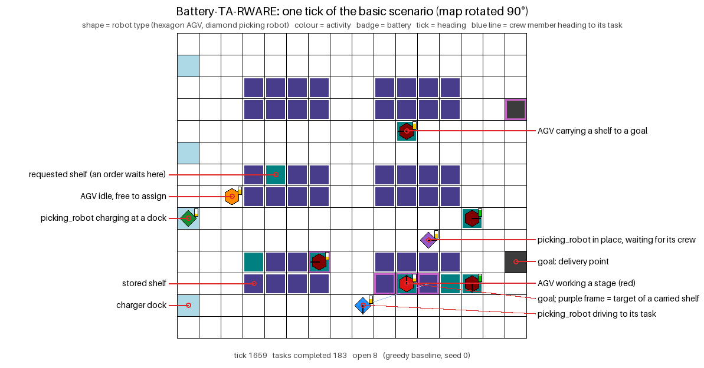
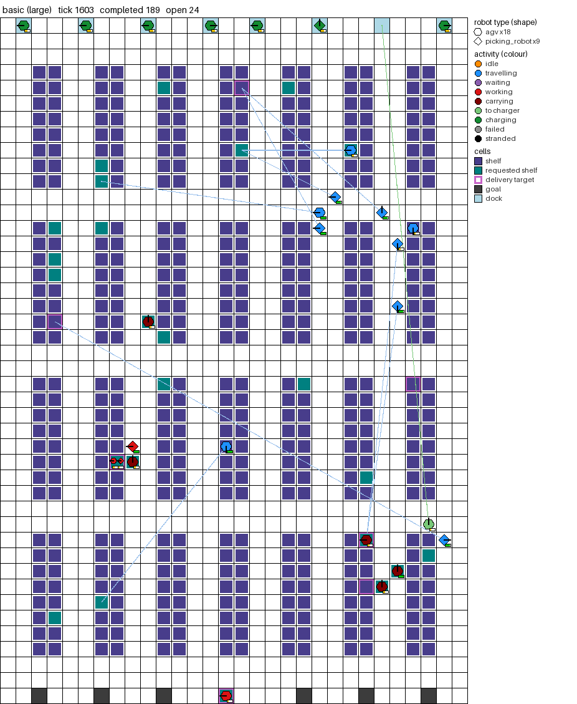
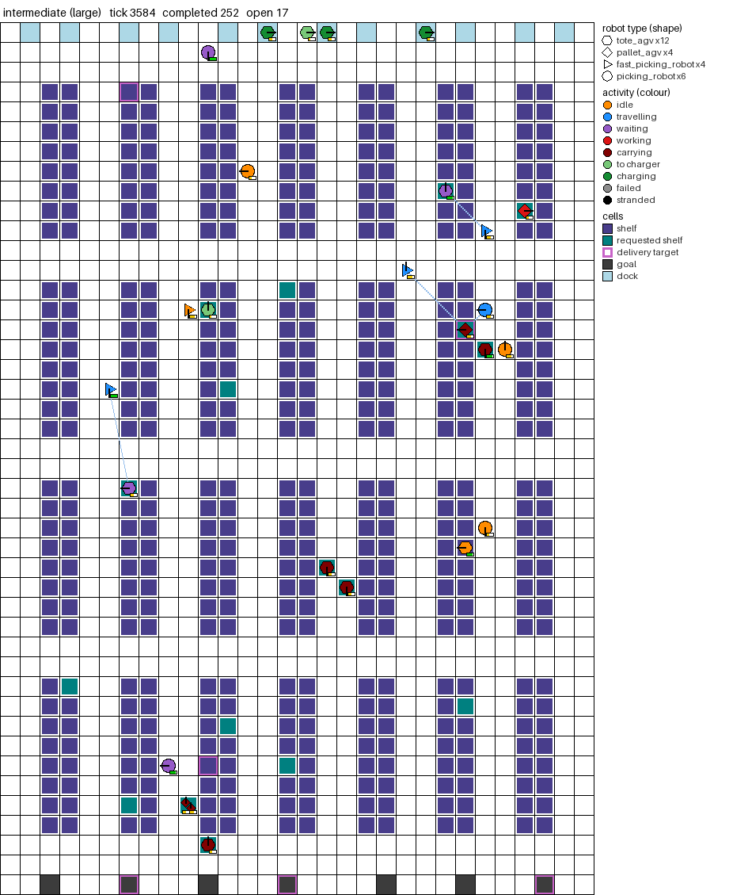
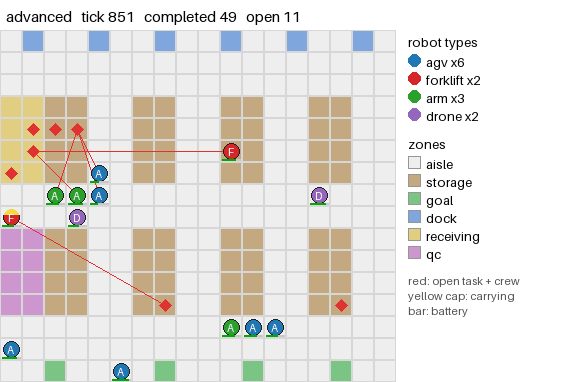
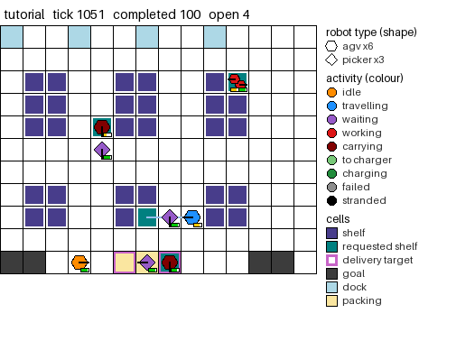
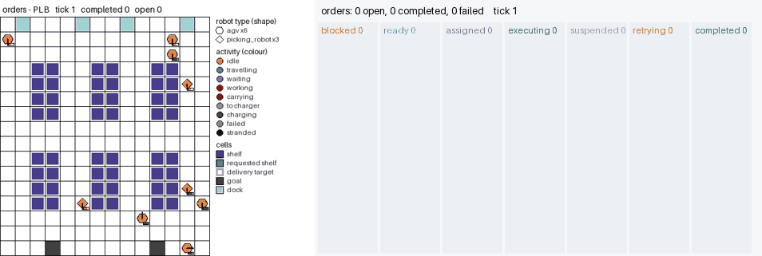
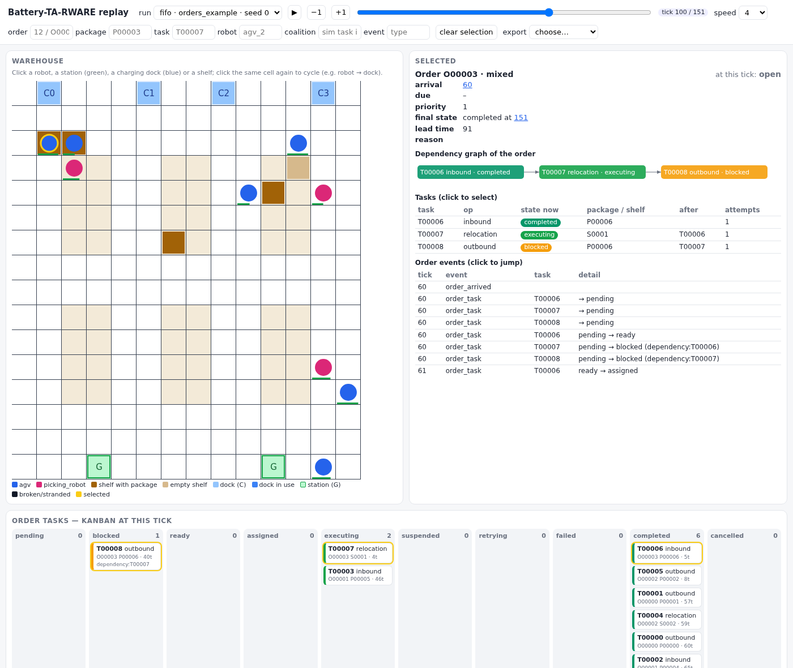

<h1 align="center">Battery-TA-RWARE: Task-Assignment Multi-Robot Warehouse with Battery Management</h1>

<p align="center">
  
</p>

**A benchmark for heterogeneous multi-robot cooperation under battery constraints**, as a
[Gymnasium](https://gymnasium.farama.org) environment with a
[PettingZoo](https://pettingzoo.farama.org) wrapper. Four things are modelled explicitly and can be
configured:

| | |
|---|---|
| **Heterogeneous capabilities** | Robots differ in what they can do (capabilities), how fast they move and work, what they can lift, where they may drive, how big their battery is and how much they can see. |
| **Cooperative task execution** | A task needs a crew: several roles, each with a capability and a count, that must meet at a place and work synchronized stages together, up to joint transport by several carriers. |
| **Dynamic demand** | Tasks arrive over time as backlog, Poisson (with peaks), batches or traces, as mixes of task types and as dependency-linked jobs, with deadlines and priorities. |
| **Shared resources** | Robots share aisles (collision-free movement), a limited set of charger docks of different types and power, and batteries that run out. |

> **Model 2.1** (the default) adds explicit occupancy, docking and waiting rules: a picking robot
> steps onto the shelf cell beside the AGV, docks are reserved, and robots route around charging or
> broken-down robots instead of waiting behind them. `model: "2.0"` reproduces model 2.0 exactly. See
> [docs/semantics.md](docs/semantics.md#model-21-occupancy-docking-and-waiting).

> **Version 2 is a new engine.** It is not trajectory-compatible with Battery-TA-RWARE v1 (branch
> [`v1`](../../tree/v1), tag `legacy-v1.1.0`), or with results obtained on the v1 kernel. The rules
> are fixed in [docs/semantics.md](docs/semantics.md) (model version 2.0). Report the package
> version with your results.

## Contents

- [Environment description](#environment-description)
  - [What does it look like?](#what-does-it-look-like)
  - [Action space](#action-space)
  - [Observation space](#observation-space)
  - [Dynamics: movement, cooperation and battery](#dynamics-movement-cooperation-and-battery)
  - [Rewards and episode end](#rewards-and-episode-end)
- [Install](#install)
- [Quick start](#quick-start)
- [Build your own scenario](#build-your-own-scenario)
- [What is configurable](#what-is-configurable)
- [Built-in scenarios](#built-in-scenarios)
- [Interfaces](#interfaces)
- [Baselines](#baselines)
- [Orders, scheduling and evaluation](#orders-scheduling-and-evaluation)
- [Citing, licence and acknowledgements](#citing-licence-and-acknowledgements)

# Environment description

A team of heterogeneous robots serves a stream of warehouse tasks on a grid. In the basic
scenario, AGVs carry totes and picking robots load them at the shelves, much as in TA-RWARE. Neither group can finish
an order alone, so the robots have to meet, at the right shelf and at the right time. Every robot
runs on a battery that it has to recharge at a limited number of shared docks.

The three built-in tiers add one kind of difficulty at a time. *Basic* couples two roles.
*Intermediate* adds heterogeneity within roles, joint transport and peak demand. *Advanced* adds
four capability types, custom zones, dependency DAGs, deadlines and breakdowns. Everything is
configuration, so the same engine runs your own fleets and tasks
([build your own scenario](#build-your-own-scenario)).

The built-in robot types stand for roles found in automated warehouses:

| Robot type | Real-world counterpart | What it does here |
|---|---|---|
| `agv`, `tote_agv`, `pallet_agv` | goods-to-person AGV / AMR | carries a tote, shelf or pallet; cannot pick items itself |
| `picking_robot`, `fast_picking_robot` | mobile piece-picking robot (mobile base + arm + gripper) | drives up beside a shelf and picks the order items into the AGV's tote; puts returned items back; carries nothing |
| `forklift` | autonomous forklift | lifts heavy pallets: receiving, put-away, relocation |
| `mobile_manipulator` | mobile manipulator at a workstation | unloads at receiving and handles goods at packing |
| `inventory_drone` | indoor inventory drone | scans shelves (cycle counts) and checks orders in the quality-check zone; small battery, noisy localization |

The environment works out which teams *can* do a task: capability, carrier capacity,
reachability and energy reserve. Your coordinator or learning agent decides who actually does
it.

## What does it look like?

The four animations show large versions of the built-in tiers and of the tutorial scenario, run by
the greedy baseline. Each shows the stretch of its episode with the most charging.

<p align="center">
  <br>
  <b>basic</b> (3×: 18 AGVs, 9 picking robots, 4 × 7 rack blocks of 2 × 8 shelves). Two roles must meet: the picking robot steps onto
  the shelf cell beside the AGV for every order, and again for the return. The robots start part-charged, so the 8 docks are contested.
</p>

<p align="center">
  <br>
  <b>intermediate</b> (2×: tote and pallet AGVs, fast and standard picking robots, 4 × 7 rack blocks of 2 × 8 shelves). Heterogeneity within
  roles, pallets only heavy AGVs can lift, oversize loads carried jointly by two AGVs, peak demand,
  fast chargers that heavy AGVs cannot use.
</p>

<p align="center">
  <br>
  <b>advanced</b> (2×: AGVs, forklifts, mobile manipulators, inventory drones; same 4 × 7 rack layout,
  receiving shelves top left, quality check bottom left). Four capability types, receiving and quality-check zones, inbound jobs linked by location, deadlines and breakdowns.
</p>

<p align="center">
  <br>
  <b>tutorial</b> (3×, same 4 × 7 rack layout, packing station in the goal row): the scenario <a href="#build-your-own-scenario">built step by step below</a>.
  Totes are picked, packed in a custom zone and delivered; pallets need two AGVs; picking robots can use
  only the standard chargers.
</p>

**What runs in the animations.** The robots are driven by the built-in reference coordinator
`GreedyCoalitionCoordinator` (FIFO), not by a tuned or published method. Every tick it:

1. sends each idle robot below 30 % state of charge to the nearest compatible dock that is free and
   not reserved (Manhattan distance; ties to the more powerful dock); robots below the threshold
   with no free dock stay where they are and try again next tick;
2. goes through the open tasks oldest first and gives each the feasible coalition of idle robots with
   the earliest estimated completion (then the least energy), keeping a 15 % battery reserve, at
   most 8 tasks per tick.

It does not plan charging ahead, balance docks between robot types, or trade tasks between robots.
Movement, docking, rendezvous and waiting follow the simulator's rules ([model 2.1](docs/semantics.md#model-21-occupancy-docking-and-waiting)),
whatever coordinator is used.

The renderer follows the TA-RWARE style:

| Element | Encoding |
|---|---|
| **Shape** | robot type, in the order of `robot_types`: hexagon, diamond, triangle, octagon, pentagon, ... (basic: hexagon = AGV, diamond = picking robot) |
| **Colour** | activity: 🟠 idle · 🔵 travelling to its task · 🟣 in place, waiting for its crew · 🔴 working a stage · 🟤 carrying (maroon) · 🟢 heading to a charger (light) / charging · ⚪ broken down (grey) · ⚫ stranded |
| **Shelves** | dark blue = stored; teal = requested (a payload waits there, or rides under its carriers); purple frame = where a carried payload is going |
| **Cells** | dark grey = goal (delivery point); light blue = charger dock; pale colours = custom zones; black = wall |
| **Badges** | the battery fill level (green > 80 %, yellow > 20 %, red below); a tick for the last move direction; a thin blue line from a crew member to the task it is heading for; a thin green line from a robot to the dock it has reserved |

`env.render()` produces the same image (`render_mode="rgb_array"` or `"human"`; numpy only). The
GIFs and the figure above come from `python docs/make_gifs.py` and `python docs/make_figure.py`
(greedy baseline, seed 0; they need Pillow). Basic robots draw little power: at the standard size
and full initial charge, the first recharges of a 2000-tick basic episode come near its end.

## Action space

`action_space = MultiDiscrete([n_actions] * n_robots)`: every robot picks one action per tick.
The scenario's `action_mode` chooses between two action sets. In both, illegal actions are
rejected, counted in `info["invalid_actions"]` and have no effect. The mask of legal actions is
`info["action_mask"]` (n_robots × n_actions), and each robot's row is also in its observation.

**Macro mode** (`action_mode: macro`, the default). Robots choose *what to do*, and movement is
automatic: shortest paths with PIBT, as described below.

| Action | Meaning | Allowed when |
|---|---|---|
| `0` | no-op: keep doing what it is doing | always |
| `1 … K` | join the task in board slot *k* and take one of its open roles | the robot has a capability for an open role, is operational, and (with `task_visibility: sensing`) can see the task |
| `K+1 … K+C` | go to charger *c* and charge there | the charger type is compatible, and the robot is not carrying |
| `K+C+1` | release: give up its role or charger | it has a commitment and is not carrying (a broken-down robot with a task can always be released; it drops its payload) |

*K* is `observation.task_slots`, the number of tasks on the board. The board lists open tasks that
still have a role to fill, in release order. *C* is the number of chargers. For the built-in
scenarios n_actions is 22 (basic), 24 (intermediate) and 28 (advanced). Joining a task that is
already running is allowed: crews are recruited stage by stage.

**Primitive mode** (`action_mode: primitive`). Robots drive themselves.

| Action | Meaning |
|---|---|
| `0` wait | stay |
| `1` up · `2` down · `3` left · `4` right | move one cell (allowed only into cells of the robot's zones, respecting one-way cells; joint carriers follow their lead) |
| `5` interact | dock at the charger the robot stands on, or join the task whose stage cell it is positioned for |
| `6` release | as in macro mode |

Centralized coordinators can skip the action vector and assign whole coalitions through the
validated simulator API (see [Interfaces](#interfaces)).

## Observation space

Each robot gets its own observation:
`observation_space = Dict({robot_name: Dict(self, robots, tasks, chargers, action_mask)})`.
All arrays are float32 and bounded. Positions are divided by the map size, energy is a state of
charge, masses are divided by the largest payload and times by `max_steps`.

| Key | Shape | Content |
|---|---|---|
| `self` | `(2 + 6 + 5 + 2 + n_types + n_caps,)` | own position (y, x); state of charge, speed, payload capacity, handling speed, battery capacity, charging flag; status one-hot (idle, task, charge, failed, stranded); carrying, has a task; robot-type one-hot; capability flags |
| `robots` | `(n_robots, 5 + 5 + n_types)` | per robot: visible flag, position, state of charge, carrying, status one-hot, type one-hot. **The row is all zeros if this robot cannot see that one.** |
| `tasks` | `(K, 14 + n_task_types + 2·n_caps)` | per board slot: present, visible, weight, origin, destination and current stage cell; stage progress, age, time to deadline, priority, "my task"; task-type one-hot; open roles per capability; required robots per capability. A task outside the sensing range shows only `present`. |
| `chargers` | `(C, 6)` | position, power, occupied, compatible with this robot, my charger |
| `action_mask` | `(n_actions,)` | this robot's legal actions (MultiBinary) |

Example sizes for basic: `self` (19,), `robots` (9, 12), `tasks` (16, 21), `chargers` (4, 6). The
information each robot gets is heterogeneous:

- **Sensing.** A robot sees other robots within its `sensing_range` (Chebyshev distance). With
  `observation.task_visibility: sensing`, the same range limits which tasks it sees.
- **Communication.** A robot also sees whatever a robot within `comm_range` sees: one relay hop,
  and both ranges must cover the distance.
- **Localization noise.** Every position a robot observes, its own included, carries Gaussian noise
  with standard deviation `localization_noise` (in cells).

The PettingZoo wrapper adds `state()`, a global vector for centralized critics. `env.state_view()`
gives the full, noise-free state as frozen objects or numpy arrays.

## Dynamics: movement, cooperation and battery

One tick runs these phases in a fixed order: actions → breakdowns → movement → stage work →
energy and charging → new demand. The full rules are in [docs/semantics.md](docs/semantics.md).

**Movement and collisions.**
- *Macro mode.* Robots move with [PIBT](https://doi.org/10.1016/j.artint.2022.103752) (Priority
  Inheritance with Backtracking): at most one cell per tick, never into an occupied cell and never
  swapping with another robot. Higher-priority robots push lower-priority ones aside, and a pushed
  robot steps aside rather than retreating ahead of its pusher. Distances respect each robot's allowed
  zones (`zones`, or `zones_loaded` while carrying) and one-way cells, and route around robots that
  stay put (charging, broken down, or standing on their own work cell).
- *Waiting.* A robot that has to wait (for a busy work cell or dock, or for its partner) waits on a
  plain aisle or storage cell that no other robot has claimed, never on a goal, dock or another
  task's work cell. Idle robots park on wide aisle cells away from goals.
- *Primitive mode.* Moves are resolved simultaneously. A stationary robot blocks its cell, the
  lowest id wins a contested cell, and swaps are rejected. Only the carriers of one payload may
  share a cell.
- Speed below 1 accumulates credit: a speed of 0.5 means one move every two ticks.
- Joint carriers move as one unit, at the speed of the slowest member.

**Cooperation.**
- A task's stages run in order. A stage advances only while every role it needs is filled and
  present (`on_cell`, or `adjacent` within `radius`) and every member is operational. This is
  the rendezvous.
- Work per tick is the slowest member's `handling_speed`.
- *Shared cells.* A cell holds one robot, except that the carriers of one task share the payload's
  cell, and a carrier and its `on_cell` crew (for example the picking robot loading the tote) share
  the cell of the stage they work. Unrelated robots never share a cell.
- The payload is picked up after the first stage and placed after the last one.
- Helpers that the next stage does not need are released, unless their role has `stay: true`.
- If the whole crew leaves after work has started, the task is *suspended* and keeps its progress.

**Battery and charging.**

Power is drawn every tick and integrated over `seconds_per_tick`:

```
P = idle_w + move_w·[moved] + payload_w_per_kg·(weight / n_carriers)·[moved while carrying] + handling_w·[worked]
```

- A dock is available, reserved, occupied or unavailable. Sending a robot to a dock reserves it; a
  dock held by another robot is refused (there is no implicit queue). Docks are destinations only:
  no robot drives through one. `map.dock_layout: bays` puts docks in bays off the corridor.
- A robot charges only on a compatible, free dock, at `min(charger power_w, max_charge_w) × charge_efficiency`.
- It stops automatically when the battery is full.
- A robot whose battery reaches 0 % is **stranded** for good: it releases its role and drops its
  payload where it stands, for another crew to recover.
- Robots can also break down at random (`failure.rate`) and sit still for `repair_ticks`.

## Rewards and episode end

The team reward is the sum of the per-robot rewards. The per-robot rewards themselves are in
`info["robot_rewards"]`, and the PettingZoo wrapper exposes them with `reward_mode="individual"`.

| Term (`rewards.*`) | Default | When, and who gets it |
|---|---|---|
| `task_completed` | 1.0 | × task `priority`, when a task completes, split equally across the crew |
| `late_per_tick` | 0.0 | × ticks past the deadline, added at completion (use a negative value) |
| `stage_completed` | 0.0 | when a stage completes, split across that stage's crew |
| `energy_per_kwh` | 0.0 | × energy each robot used this tick (use a negative value) |
| `stranded` | −1.0 | once, when a robot's battery runs out |
| `per_tick` | 0.0 | every robot, every tick |

- `terminated`: the demand is finite and everything is done, or every robot is stranded.
- `truncated`: `max_steps` has been reached.
- `info` also holds:
  - `events`: typed transitions, such as `task_completed`, `stage_started`, `payload_dropped`,
    `charge_started`, `robot_stranded`, ...;
  - `metrics`: tasks completed and open, latency, lateness, energy, distance, stranded robots.

Every random process (spawn positions, demand, task sampling, failures and observation noise) has
its own seeded stream, so `reset(seed)` reproduces a run exactly.

## Install

Python ≥ 3.10.

```bash
pip install "battery-ta-rware @ git+https://github.com/Cyber-physical-Systems-Lab/Battery-TA-RWARE@v2.1.0"
# with the optional extras (PettingZoo, YAML scenarios, matplotlib window):
pip install "battery-ta-rware[all] @ git+https://github.com/Cyber-physical-Systems-Lab/Battery-TA-RWARE@v2.1.0"
```

Or install from a clone:

```bash
git clone https://github.com/Cyber-physical-Systems-Lab/Battery-TA-RWARE.git
cd Battery-TA-RWARE
pip install -e ".[all]"
```

The base install needs only `numpy` and `gymnasium`. The optional extras are `pettingzoo`, `yaml`,
`render` (matplotlib) and `gifs` (Pillow), or `all`. The distribution is called
`battery-ta-rware`; the Python package is imported as `battery_tarware`.

## Quick start

```python
import gymnasium as gym
import numpy as np
import battery_tarware as bt        # registers battery_tarware/{Basic,Intermediate,Advanced,Warehouse}-v2

env = gym.make("battery_tarware/Intermediate-v2")
obs, info = env.reset(seed=0)
rng = np.random.default_rng(0)
for _ in range(100):
    mask = info["action_mask"]                                   # (n_robots, n_actions), 1 = allowed
    action = [rng.choice(np.flatnonzero(m)) for m in mask]       # a random valid action per robot
    obs, reward, terminated, truncated, info = env.step(action)
print(info["metrics"])

# or let a coordinator drive a whole episode
metrics = bt.run_episode(bt.make("advanced"), bt.GreedyCoalitionCoordinator("edd"), seed=0)
```

More examples are in [examples/](examples):

- [quickstart.py](examples/quickstart.py): a masked random policy and the greedy baseline.
- [pettingzoo_and_primitive.py](examples/pettingzoo_and_primitive.py): the PettingZoo API and
  primitive (move-level) actions.
- [external_coordinator.py](examples/external_coordinator.py): your own coordinator on read-only
  state views and numpy arrays.
- [custom_scenario.py](examples/custom_scenario.py) and
  [custom_scenario.yaml](examples/custom_scenario.yaml): a hospital-logistics fleet.
- [tutorial.yaml](examples/tutorial.yaml): the scenario built in the next section.

## Build your own scenario

A scenario is a plain mapping (a Python dict, a JSON file or a YAML file) that is validated on
load. The full file of this walkthrough is [examples/tutorial.yaml](examples/tutorial.yaml), and
every field is documented in [docs/configuration.md](docs/configuration.md).

**1. Map.** Draw it in ASCII or use the generator. Custom zones get their own symbol.

```yaml
map:
  ascii:
    - "C..C..C..C...."        # C charger dock
    - ".............."        # . aisle
    - ".SS..SS..SS..."        # S storage
    - ".SS..SS..SS..."
    - ".............."
    - "GG...PPP...GG."        # G goal, P custom zone
  zones: {P: packing}
# or: map: {generator: {rack_rows: 2, rack_cols: 3, rack_height: 4, goals: 2, docks: 4, aisle_width: 2}}
```

One-way cells (`^ v < >`) and crossings (`+`) are optional, as are walls (`#`).

**2. Robot types.** A robot type sets what a robot can do (capabilities), how it moves and works,
its battery, what it can see and how often it breaks down.

```yaml
robot_types:
  - name: agv
    capabilities: [transport]
    speed: 1.0                                   # cells per tick, (0, 1]
    payload_kg: 80
    zones: [aisle, storage, goal, dock, packing]
    zones_loaded: [aisle, goal, dock, packing]   # not under racks while loaded
    energy: {capacity_wh: 300, idle_w: 20, move_w: 140, payload_w_per_kg: 1.5, handling_w: 40}
  - name: picking_robot                          # mobile base + arm: picks items into the AGV's tote
    capabilities: [pick, pack]
    speed: 0.5                                   # one cell every two ticks
    handling_speed: 1.5                          # works stages 1.5x faster
    zones: [aisle, dock, packing]
    charger_types: [standard]                    # cannot use fast chargers
    sensing_range: 5                             # partial observability
    energy: {capacity_wh: 250, idle_w: 15, move_w: 90, handling_w: 120}
    failure: {rate: 0.0002, repair_ticks: 30}    # random breakdowns
```

**3. Fleet.** Set how many robots of each type there are and their initial charge. A group can
override fields of its type, for example to model an aged battery.

```yaml
fleet:
  - {type: agv, count: 5, initial_soc: [0.5, 1.0]}
  - {type: agv, name: agv_old, count: 1, overrides: {energy: {capacity_wh: 180}}}
  - {type: picking_robot, count: 3}
```

**4. Chargers.** Charger types differ in power, and each type takes a share of the docks.

```yaml
charger_types:
  - {name: standard, power_w: 800, share: 1}
  - {name: fast, power_w: 2500, share: 1}
```

**5. Task types.** A task type defines its roles (who is needed, how many, and how close they must
be) and its stages (where, how long and with which roles). The `carrier_role` holds the payload. A
carrier role with `count > 1` means joint transport.

```yaml
task_types:
  - name: tote
    carrier_role: carrier
    weight: {kind: uniform, low: 1, high: 15}
    deadline: 300
    roles:
      - {name: carrier, capability: transport, presence: on_cell}
      - {name: picker, capability: pick, presence: adjacent, radius: 1}
    stages:
      - {name: pick, at: origin, roles: [carrier, picker], duration: 3}
      - {name: pack, at: "zone:packing", roles: [carrier, picker], duration: 2}
      - {name: drop, at: destination, roles: [carrier], duration: 1}
  - name: pallet                                 # 90-150 kg: two 80 kg AGVs must carry it together
    carrier_role: carriers
    priority: 2
    weight: {kind: normal, mean: 110, std: 15, low: 90, high: 150}
    roles:
      - {name: carriers, capability: transport, count: 2, presence: on_cell}
    stages:
      - {name: lift, at: origin, roles: [carriers], duration: 4}
      - {name: drop, at: destination, roles: [carriers], duration: 2}
```

**6. Jobs (optional).** A job links tasks by dependencies and by location.

```yaml
jobs:
  - name: order_and_return
    tasks:
      - {key: order, type: tote}
      - {key: back, type: return_tote, depends_on: [order], origin_from: order.destination}
```

**7. Demand.** Demand comes from any number of streams. Each stream is a backlog, Poisson arrivals
(constant or piecewise rates), a batch, or a trace of release times.

```yaml
demand:
  - {kind: backlog, open: 3, task_type: tote}                               # always 3 totes waiting
  - {kind: poisson, task_type: pallet, rates: [[0, 0.005], [1000, 0.02]]}   # a peak after tick 1000
  - {kind: poisson, job: order_and_return, rate: 0.004}
```

**8. Rewards, observations and episode length.**

```yaml
rewards: {task_completed: 1.0, late_per_tick: -0.01, energy_per_kwh: -0.2, stranded: -10.0}
observation: {task_slots: 8, task_visibility: global}
max_steps: 2000
action_mode: macro            # or primitive
```

**9. Run it.**

```python
env = bt.make("examples/tutorial.yaml")              # a path, a dict or a bt.ScenarioConfig
env = gym.make("battery_tarware/Warehouse-v2", scenario="examples/tutorial.yaml")

cfg = bt.get_scenario("advanced")                    # or start from a built-in and edit it
cfg["fleet"][0]["count"] = 10
env = bt.make(cfg, max_steps=3000, action_mode="primitive")   # top-level overrides
```

Configuration mistakes are rejected with an explanation. Examples are unknown keys, a capability
no robot has, a load heavier than the strongest possible carrier crew, a dependency cycle or an
unknown zone:

```
ConfigError: task type 'solo': role 'carrier' needs 1 robot(s) with 'fly', fleet has 0
```

## What is configurable

Each robot type sets the fields below; each fleet group can override them.

| Dimension | Fields | Effect |
|---|---|---|
| **Capability** | any set of strings: `transport`, `pick`, `lift`, `inspect`, `manipulate`, ... | which task roles a robot can fill |
| **Physical performance** | `speed` (cells per tick, fractional), `payload_kg`, `handling_speed`, `zones`, `zones_loaded` | travel time; what it may carry; how fast it works; where it may drive, empty or loaded |
| **Resources** | battery: `capacity_wh`, `idle_w`, `move_w`, `payload_w_per_kg`, `handling_w`, `max_charge_w`, `charge_efficiency`; compatible `charger_types`; `initial_soc` range; breakdowns: `failure.rate`, `repair_ticks` | how long it can work; where and how fast it recharges; when it is out of service |
| **Information** | `sensing_range`, `comm_range` (one-hop relay), `localization_noise`; task board `global` or `sensing` | what each robot observes |
| **Cooperation** | per task type: roles `{capability, count, presence (on_cell or adjacent), radius, stay}`, ordered stages `{at, roles, duration}`, a `carrier_role` | crew composition, rendezvous and synchronized work; joint transport when the carrier role has `count > 1` |

Tasks, demand and the environment are configured the same way:

| | Options |
|---|---|
| **Task types** | any number of them; roles; stages at `origin`, `destination` or any `zone:<name>`; payload `weight` (`fixed`, `uniform`, `normal`, `choice`); `priority`; `deadline`; `origin` and `destination` zones |
| **Jobs** | dependency DAGs of tasks, with location chaining (`origin_from: "order.destination"`) |
| **Demand** | `backlog`, `poisson` (constant or piecewise `rates`), `batch`, `trace`; one task type, one job or a weighted `mix` per stream; any number of streams |
| **Chargers** | several types, each with its own `power_w` and `share` of the docks |
| **Map** | ASCII (custom zone symbols, one-way cells, walls) or a generator (`rack_rows`, `rack_cols`, `rack_height`, `goals`, `docks`, `aisle_width`, `one_way`) |
| **Rewards** | task completion (× priority), stage completion, energy (per kWh), lateness (per tick), stranding, per tick |

A coalition is *feasible* only if all of the following hold:

- every role is filled by distinct, operational robots with the right capability;
- the carriers' combined payload capacity covers the load;
- every member can reach its cells within its allowed zones;
- every member's estimated energy for its part leaves a reserve.

`env.unwrapped.sim.feasible_coalitions(task_id)` enumerates the feasible coalitions, ranked by
estimated completion time.

## Built-in scenarios

Each tier adds new cooperation constraints, not just more robots.

| Scenario | Gym id | Robots | Tasks | Main challenges |
|---|---|---|---|---|
| `basic` | `battery_tarware/Basic-v2` | 6 AGVs, 3 picking robots | SOLO (1 AGV), STANDARD (AGV + picking robot on its shelf cell) and LARGE (AGV + 2 picking robots: one on the shelf cell, one beside it), each picked, delivered and returned | role coupling: picking robots are needed at pickup and at return |
| `intermediate` | `battery_tarware/Intermediate-v2` | light/fast tote AGVs and heavy/slow pallet AGVs (one group with an aged battery), fast and standard picking robots | totes, cases, pallets (heavy AGVs only), oversize loads carried jointly by two AGVs | heterogeneity within roles, joint transport, peak and trough demand, fast chargers that heavy AGVs cannot use, picking robots that sense only 6 cells |
| `advanced` | `battery_tarware/Advanced-v2` | AGVs, forklifts, mobile manipulators, inspection drones | orders through a quality-check zone, bulky joint orders, inbound jobs (receive → inspect, linked by location), relocations | 4 capability types, custom zones, dependency DAGs, deadlines, breakdowns, noisy drones with small batteries |

`battery_tarware/Warehouse-v2` runs any scenario. `bt.get_scenario(name)` returns a built-in as an
editable dict.

**Scaling up.** Any scenario can be made larger by editing its dict: the map generator (or the
ASCII map), the fleet counts, the demand and `observation.task_slots`. `scale()` in
[docs/make_gifs.py](docs/make_gifs.py) builds the large versions in the animations. All four
use a 4 × 7 grid of rack blocks with 2 × 8 shelves each: basic 3×; intermediate 2×; advanced 2×,
with receiving and quality-check shelves in the corner blocks; tutorial 3×, at 2× demand.
All four run without stranding a robot. For example, basic at 3× on a 4 × 7 grid of rack blocks, each 2 shelves wide and 8 deep (44 × 30 cells):

```python
cfg = bt.get_scenario("basic")
cfg["map"] = {"generator": {"rack_rows": 4, "rack_cols": 7, "rack_height": 8, "goals": 7, "docks": 8}}
for group in cfg["fleet"]:
    group["count"] *= 3                      # 18 AGVs, 9 picking robots
    group["initial_soc"] = [0.25, 0.6]
cfg["demand"][0]["open"] *= 3                # 24 tasks kept open
cfg["observation"] = {"task_slots": 32}
env = bt.make(cfg)                           # greedy baseline: about 220 tasks in 2000 ticks
```

## Interfaces

**Gymnasium** (`BatteryTarwareEnv`): see [Action space](#action-space) and
[Observation space](#observation-space). The render modes are `rgb_array`, `ansi` and `human`
(matplotlib).

**PettingZoo**: `battery_tarware.pettingzoo_env.BatteryTarwareParallelEnv(scenario, reward_mode="individual" | "team")`
passes `pettingzoo.test.parallel_api_test`. It also provides `state()` for centralized critics.

**Coordinators** are objects with `reset(env)` and `act(env) -> actions`.

- A centralized coordinator can also call the validated simulator API on `env.unwrapped.sim`:
  `assign`, `assign_coalition`, `release`, `send_to_charger` and `feasible_coalitions`. Every call
  returns `(ok, reason)`.
- Two reference baselines are built in. `GreedyCoalitionCoordinator` assigns feasible coalitions
  greedily and recharges below a threshold. Its task order is a standard dispatching rule
  (`fifo` by default; the others are listed in `bt.RULES`). `RandomCoordinator` is a masked
  random policy. They are reference points, not tuned methods.

**State for external code**: `env.unwrapped.state_view()` is a frozen snapshot of the robots, tasks
and chargers. `.to_arrays()` returns contiguous, fixed-dtype numpy arrays (schema version 1, int32
`(row, col)` coordinates). C++ or other native coordinators can read them directly, for example
through pybind11 `py::array_t`.

## Baselines

These are full-length episodes over seeds 0–4, produced by `python benchmarks/baselines.py`:

| Scenario | Policy | Tasks completed | Mean latency (ticks) | Late | Energy (kWh) | Stranded |
|---|---|---|---|---|---|---|
| basic | greedy (FIFO) | 203.6 ± 12.6 | 77 | 0.0 | 2.59 | 0.0 |
| basic | random (masked) | 5.4 ± 1.6 | 567 | 0.0 | 3.01 | 0.0 |
| intermediate | greedy (FIFO) | 135.0 ± 9.2 | 66 | 0.0 | 3.05 | 0.0 |
| intermediate | random (masked) | 13.8 ± 2.8 | 483 | 0.0 | 6.81 | 3.0 |
| advanced | greedy (FIFO) | 298.8 ± 28.5 | 201 | 2.0 | 9.70 | 0.0 |
| advanced | greedy (priority) | 288.4 ± 12.4 | 204 | 2.2 | 9.31 | 0.0 |
| advanced | random (masked) | 1.4 ± 0.8 | 116 | 0.0 | 13.95 | 0.8 |

These are model 2.1 numbers. In basic, model 2.1 changes the picking geometry (the picker has to
reach the shelf cell), which can lower throughput slightly against model 2.0; the change is
intentional, not a performance optimization.

Compare these numbers only within a scenario. The tiers differ in map size, fleet, demand process,
task mix and episode length. Raw task counts are therefore not normalized for difficulty and do not
rank the tiers: advanced completing more tasks than basic does not make it easier. Intermediate is
demand-limited; its Poisson arrivals, not the fleet, cap throughput.

On one CPU core the simulator runs about 400–1100 ticks per second with the greedy baseline.

## Orders, scheduling and evaluation

> In development on branch `feat/orders-scheduling` (not in a release yet). Everything is opt-in:
> a scenario without an `orders:` key runs tick for tick as before.

<p align="center">
  
</p>

With an `orders:` block, work arrives as **orders** (inbound, outbound, relocation; several lines;
dependencies between their tasks) over a persistent **inventory** of packages on shelves at rack
locations. Package ids persist across operations. Tasks are released to the simulator only when their
dependencies, inventory and access conditions hold. A task can be suspended, failed and retried, and
an order can be cancelled; every such transition has a recorded reason.

```python
from battery_tarware.orders import order_scenario, run_episode, write_dashboard
res = run_episode(order_scenario(), rule="plb", seed=0, max_steps=2000)
print(res["metrics"]["primary"])                 # throughput, lead time, on-time rate, energy/order, ...
write_dashboard([res["trace"]], "dashboard.html")  # offline replay, open in a browser
```

or `python examples/orders_quickstart.py examples/orders.yaml fifo` (a scripted trace with inbound,
outbound, relocation and a three-task dependent order).

**Scheduling.** `OrderScheduler(rule)` runs one pipeline for every rule: the shared charging rule;
the eligible set; feasible coalitions from the simulator (capabilities, role alternatives, payload,
reachability, 15% battery reserve), with a reason for each infeasible task; then ranking and atomic
commits. Rules differ only in the ranking:

| Rule | Ranks | Key |
|---|---|---|
| `fifo` / `edd` / `lwf` | tasks | order arrival / due date / longest wait since the task last became open |
| `wsp` (`wsp_eq`) | tasks | 0.45·priority + 0.30·min(wait/100, 1) + 0.25·type score (outbound 0.8, inbound 0.6, relocation 0.4; `wsp_eq`: equal type scores) |
| `spt` / `cr` | tasks | remaining processing estimate / (due − now) ÷ processing estimate |
| `nsp` | pairs | crew arrival time |
| `zlp_2d` | pairs | 0.8·zone affinity (rack-block zones; 1.0 / 0.7 / 0.3) + 0.2·priority |
| `plb` | pairs | 0.4·(1 − path conflict) + 0.3·workload balance + 0.3·(1 − crew path length) |

Every tick writes a `schedule_decision` event: the candidates, their scores, the feasible coalitions,
and each task's outcome or rejection reason.

**Metrics and diagnosis.** `TraceRecorder` adds per-tick robot frames and a cause per waiting task
(sequencing, coalition unavailable, charging contention, congestion, dependency, ...) to the event
log. `evaluate(trace)` reports order, scheduling, robot, coalition and system metrics, censoring
unfinished work, and diagnoses each unsuccessful order with an evidence span
([docs/metrics.md](docs/metrics.md)).

**Dashboard.** `write_dashboard(traces, path)` (or `python -m battery_tarware.orders.dashboard
trace.json -o dashboard.html`) writes one self-contained HTML file. It offers playback, the map,
an order-task kanban, order flow (cumulative arrived and completed) and throughput charts, the order
queue, the dependency graph, scheduler decisions, robots, packages, stations and charging docks,
battery, a cause timeline, metrics, and diagnosis with jump-to-evidence. Click an order, task,
robot, package, or a station, dock or shelf on the map to see its details and history; a station
shows its deliveries, service and occupancy, and a dock its sessions, energy and occupancy. You can
filter by run, order, package, task, robot, coalition or event, and export CSV or JSON. A deep link
such as `#run=1&t=300&order=O00012` or `#t=900&charger=0` opens a given view.

<p align="center"></p>

**Evaluation.** The experiments live in `experiments/orders/`:
- `exploratory.py`: one factor at a time (arrival rate, task mix, coalition size, fleet
  heterogeneity, battery and docks, layout), paired seeds and bootstrap CIs;
- `confirmatory.py`: a pre-registered protocol on fresh seeds;
- `scalability.py`.

Results and commands are in [experiments/orders/RESULTS.md](experiments/orders/RESULTS.md). The
pre-registered confirmatory run (20 fresh seeds, Bonferroni-corrected CIs) supports 7 of 9
hypotheses in the basic-warehouse family:
- NSP raises throughput over FIFO at base load (+7.9 orders per 1,000 ticks; FIFO 79.9), with
  larger coalitions (+17.1) and with tight batteries (+9.4).
- NSP cuts mean lead time from 186 to 93 ticks at base load.
- LWF is slower than FIFO.
- When demand-limited, NSP and FIFO are equivalent.
- PLB did not beat FIFO: on one seed it drove the fleet into a model 2.1 gridlock (see the known
  limitations below).
- WSP's operation-type weights did not measurably shorten lead time against the equal-type
  ablation.

These are results for this simulator and these scenarios, not general claims about the rules.

**Known limitation (model 2.1).** Model 2.1 can deadlock through hold-and-wait. A picking robot
working from a cell next to its own task's shelf may stand on another task's work cell. That
task's loaded AGV then waits for the cell, and the waiting crews block the aisle the first task
still needs. This happened in 2 of 1,480 evaluation runs, both under PLB. The stall detector
reports it, and the diagnosis names it "navigation deadlock". Reproduce it with
`python validation/orders/known_gridlock.py`. Model 2.1 is frozen, so this is documented here rather
than changed.

The design and its modelling assumptions are in
[docs/design/orders_and_scheduling.md](docs/design/orders_and_scheduling.md).

## Citing, licence and acknowledgements

If you use Battery-TA-RWARE, please cite it using [CITATION.cff](CITATION.cff) and state the
package version:

```bibtex
@software{battery_ta_rware,
  author  = {Niu, Xuezhi},
  title   = {Battery-TA-RWARE: heterogeneous multi-robot cooperation under battery constraints},
  version = {2.1.0},
  year    = {2026},
  url     = {https://github.com/Cyber-physical-Systems-Lab/Battery-TA-RWARE}
}
```

Battery-TA-RWARE grew out of [TA-RWARE](https://github.com/raulsteleac/task-assignment-robotic-warehouse)
(Krnjaic et al., 2022), which builds on [RWARE](https://github.com/semitable/robotic-warehouse)
(Papoudakis et al., 2021). Version 2 is a new engine. The macro-mode movement is an independent
implementation of PIBT (Okumura et al., 2022) with a restricted swap operation (Okumura, 2023). See
[ACKNOWLEDGEMENTS.md](ACKNOWLEDGEMENTS.md) for full credits.

The v1 environment (package `tarware`) remains available on the [`v1`](../../tree/v1) branch and at
tag `legacy-v1.1.0`.

The software is released under the MIT licence; see [LICENSE](LICENSE). Changes are listed in
[CHANGELOG.md](CHANGELOG.md).
